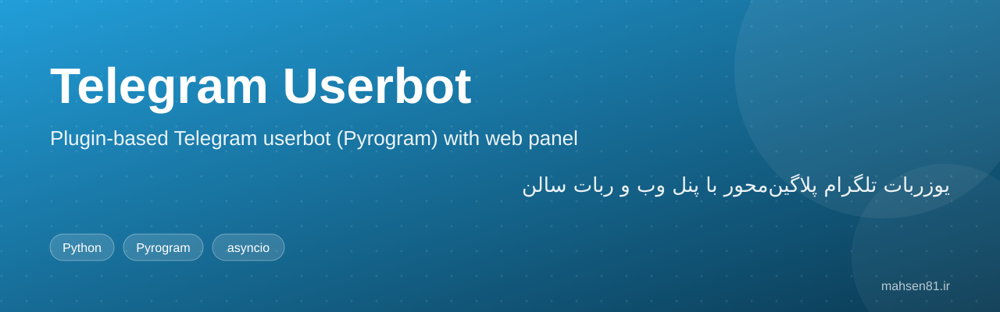

<!-- gen:header -->
<p align="center"></p>

<h1 align="center">Telegram Userbot</h1>
<p align="center"><b>یوزربات تلگرام پلاگین‌محور با پنل وب و ربات سالن</b><br><i>Plugin-based Telegram userbot (Pyrogram) with web panel</i></p>
<p align="center">  </p>

<div dir="rtl">

## ✨ امکانات

- سیستم پلاگین با بارگذاری خودکار
- مدیریت FloodWait و تلاش مجدد
- پنل وب و اجرای خودکار در ویندوز
- نمونه‌ی ربات نوبت‌دهی سالن

</div>

## 🚀 Quick start

```bash
pip install -r requirements.txt
copy .env.example .env
python gen_session.py
python main.py
```

---

<!-- gen:docs -->
## 📚 مستندات کامل · Full documentation

# Telegram Userbot (Pyrogram / Kurigram)

## Structure
```
bot/
├── main.py            # entry point
├── config.py          # loads .env
├── gen_session.py     # one-time SESSION_STRING generator
├── requirements.txt
├── .env.example
├── core/
│   ├── decorators.py  # @command, @on_message, edit()
│   ├── flood.py       # safe_call(): FloodWait + backoff
│   ├── loader.py      # importlib plugin loader
│   └── logger.py      # logging setup
├── plugins/
│   ├── system.py      # .ping .alive .help
│   ├── tools.py       # .purge .edit
│   └── afk.py         # .afk on/off + PV auto-reply
├── sessions/          # file sessions (git-ignored)
└── data/              # plugin state (git-ignored)
```

## Get API_ID / API_HASH
1. Open https://my.telegram.org and log in with your phone number (code arrives inside Telegram).
2. Click **API development tools**.
3. Fill App title + Short name (anything), platform `Desktop`, then **Create application**.
4. Copy `App api_id` and `App api_hash`. Never share them.

## Run locally
```bash
python -m venv .venv
.venv\Scripts\activate          # Linux/macOS: source .venv/bin/activate
pip install -r requirements.txt
copy .env.example .env          # Linux/macOS: cp .env.example .env
# edit .env: API_ID, API_HASH
python main.py                  # first run asks phone + code (+ 2FA password)
```

## Run on a server
1. Locally: `python gen_session.py`. The string goes to your Saved Messages.
2. On the server put it in `.env` as `SESSION_STRING`, then `chmod 600 .env`.
3. Run as a systemd service (auto-restart):
```ini
# /etc/systemd/system/userbot.service
[Unit]
Description=Telegram userbot
After=network-online.target

[Service]
User=userbot
WorkingDirectory=/opt/userbot
ExecStart=/opt/userbot/.venv/bin/python main.py
Restart=always
RestartSec=10

[Install]
WantedBy=multi-user.target
```
`sudo systemctl enable --now userbot` then `journalctl -u userbot -f`.

## Write a plugin
Create `plugins/hello.py`, restart. No core changes.
```python
from core import command, edit

@command("hello", "Say hi")
async def hello(client, message):
    await edit(message, "Hi 👋")
```
Disable a plugin: rename to `_hello.py`.

---

<p align="center">ساخته‌شده توسط <a href="https://mahsen81.ir"><b>محسن جباره‌اصل</b></a> — برنامه‌نویسی، طراحی سایت، ربات و هوش مصنوعی<br>
Built by <a href="https://mahsen81.ir">Mohsen Jabbareh-Asl</a> · ⭐ اگر مفید بود، ستاره بدهید · Need a custom version? <a href="https://mahsen81.ir">Get in touch</a></p>
